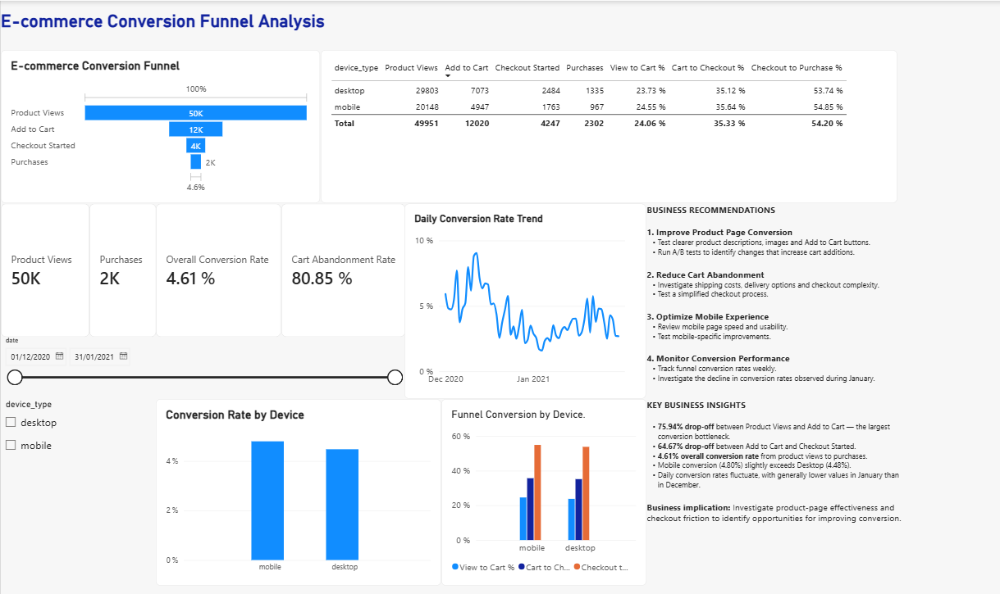

# E-commerce Conversion Funnel Analysis

### SQL | Google BigQuery | Power BI | DAX

## Project Overview

This project analyzes e-commerce shopping activity to identify conversion bottlenecks and recommend opportunities for improving the customer journey.

The analysis uses a public Google Analytics 4 sample dataset, processed with SQL in Google BigQuery and visualized in Microsoft Power BI.

## Power BI Dashboard

## Business Problem

An e-commerce business needs to understand where shopping activity decreases most significantly between product views and completed purchases.

The goal is to identify which stage should be investigated first to improve conversion performance.

## Tools and Skills

- SQL: data extraction, CTEs, aggregation
- Google BigQuery: querying GA4 event data
- Power BI: interactive dashboard and visualizations
- DAX: conversion rates and funnel metrics
- Business analysis: KPI interpretation and recommendations

## Key Results

| Metric | Result |
|---|---:|
| Product Views | 49,951 |
| Add to Cart | 12,020 |
| Checkout Started | 4,247 |
| Purchases | 2,302 |
| View-to-Cart Rate | 24.06% |
| Purchase-to-View Ratio | 4.61% |
| View-to-Cart Drop-off | 75.94% |

## Key Findings

1. The largest decrease in recorded activity occurs between product views and add-to-cart events.
2. Mobile has a slightly higher purchase-to-view ratio (4.80%) than desktop (4.48%).
3. The early shopping stage is a strong candidate for further investigation.

## Business Recommendations

- Improve product information and page clarity.
- Test more visible add-to-cart buttons.
- Conduct usability research to understand shopping friction.
- Use A/B testing to evaluate changes.
- Monitor completed purchases alongside add-to-cart activity.

## Limitations

The dataset covers a limited historical period.

The reported funnel metrics are based on aggregated event counts, which do not necessarily represent unique customers.

The analysis identifies where activity decreases but cannot establish why customers leave or prove the effect of proposed improvements.

## Project Files

The repository will include:
- SQL analysis queries
- Power BI dashboard
- Dashboard screenshots
- Final analytical report

## Author

Olesia Pidgorodynska

MSc Business Analytics  
Bucharest University of Economic Studies (ASE)
